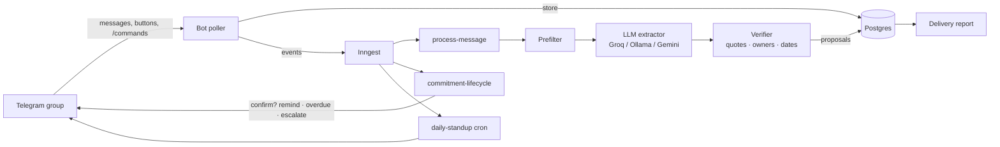

# TeamCaptain 🧭

[](https://github.com/Akshu24Tech/teamcaptain/actions/workflows/ci.yml)
[](https://github.com/Akshu24Tech/teamcaptain/actions/workflows/ci.yml)
[](pyproject.toml)
[](#)

**An autonomous AI agent that turns group conversations into verified, self-managing commitments.**

🌐 **[Live project page →](https://akshu24tech.github.io/teamcaptain/)**

Teams don't assign work in Jira. They make promises in group chats ("I'll do the PPT by
Friday", "Rahul DB kal tak dekh lena"), and those promises get lost. TeamCaptain sits in a
Telegram group, detects commitments in natural conversation, asks the accountable person to
confirm, then tracks each one for days: reminding before the deadline, following up when it's
overdue, escalating to the team, and producing a transparent delivery report.

Runs entirely on free tools: Groq/Gemini free tiers or a local Ollama model, Postgres,
the Inngest dev server and the Telegram Bot API.

## What makes it hard (and interesting)

| Problem | How it's solved |
|---|---|
| Detecting commitments in casual English/Hinglish chat | LLM extraction with context, behind a cheap deterministic prefilter |
| LLMs hallucinate quotes, people and dates | A verifier: evidence must be verbatim, owners must be real members, dates are computed by code, never by the model |
| "kal", "next friday", "end of week", "15/11" | Deterministic deadline resolver with documented conventions and 30+ tests |
| Never tracking a wrong task | Human-in-the-loop: only the accountable person can confirm |
| Workflows that last days and survive crashes | Inngest durable steps, waits and cancellation; DB re-checked before every message |
| Fairness | Report counts only confirmed commitments and shows raw numbers; measures reliability, not workload |
| Proving it works | Labeled dataset + evaluation harness: precision, recall, deadline accuracy, false-alarm rate, model comparison |

## Architecture



## Quick start

1. **Free LLM key:** create one at [console.groq.com](https://console.groq.com) (no card), or
   install [Ollama](https://ollama.com) and run `ollama pull qwen2.5:7b`.
2. **Telegram bot:** message @BotFather → `/newbot`, copy the token, then `/setprivacy` →
   choose your bot → **Disable** (so it can read normal group messages).
3. **Configure:** `cp .env.example .env` and fill in `LLM_API_KEY` and `TELEGRAM_BOT_TOKEN`.
4. **Run** (needs Docker and [uv](https://docs.astral.sh/uv/)):
   ```bash
   uv sync
   docker compose up -d
   uv run uvicorn tc.main:app --port 8000      # terminal 1
   uv run python -m tc.bot.poller              # terminal 2
   ```
5. Add the bot to a group and chat. Watch every workflow step at http://localhost:8288.

## Deploy it live (always-on, ₹0)

Run TeamCaptain 24/7 without your laptop. In production the bot switches from long polling to a
**webhook**, so the whole system is a single web service — hosted free on Render, with Neon
(Postgres), Inngest Cloud (workflows) and Groq (LLM). No credit card needed.

→ **Step-by-step guide: [docs/DEPLOY.md](docs/DEPLOY.md)**

```bash
uv run python -m tc.bot.set_webhook          # point Telegram at your deployed URL
uv run python -m tc.bot.set_webhook --delete # revert to local long polling
```

## Commands in the group
`/tasks` · `/done N` · `/take N` · `/deadline N friday 5pm` · `/cancel N` · `/report` · `/help`

## Evaluation

```bash
uv run python -m tc.evaluation --extractor rules     # no-AI baseline
uv run python -m tc.evaluation --extractor llm       # model from .env
uv run python -m tc.evaluation --extractor llm --model qwen2.5:7b \
    --base-url http://localhost:11434/v1             # local model
```

Current baseline on the 50-example seed set (`evals/dataset.jsonl`, written by hand, so treat
as a smoke test until it's expanded with real chats):

| extractor | precision | recall | F1 | deadline accuracy | false alarms on non-tasks |
|---|---|---|---|---|---|
| rule-based | 0.93 | 0.74 | 0.83 | 0.92 | 5.9% |

The rules were written alongside this seed set, so they flatter themselves here. The real test
is the expanded dataset and the LLM comparison (see `docs/PLAN.md`).

## Tests
```bash
uv run pytest -q    # 63 tests: dates, verifier, extractors, scoring, bot flow on SQLite
```
