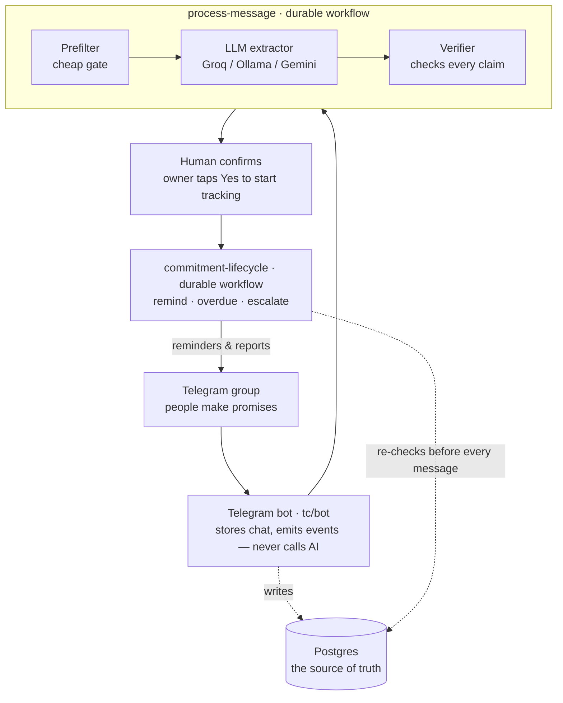
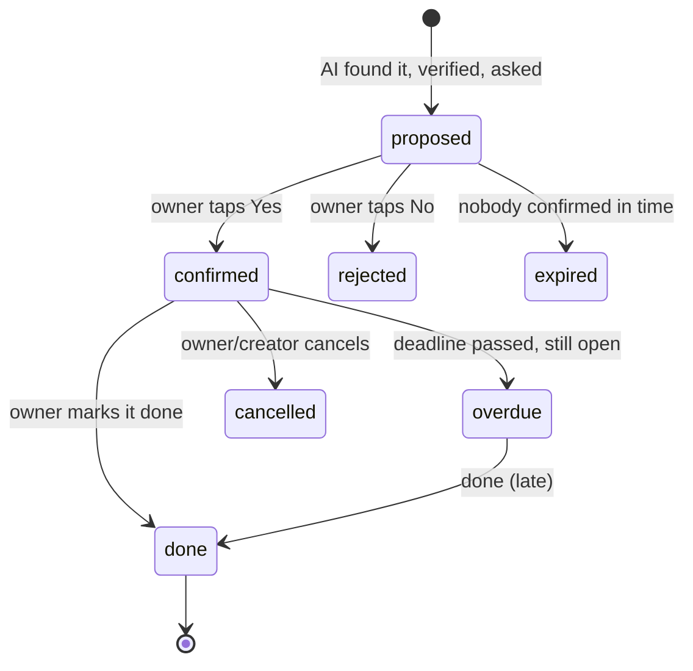

# TeamCaptain — architecture

A guide you can read straight from to explain the system to anyone, even if they've
never seen the code.

## The one-sentence version

> TeamCaptain sits in a group chat, notices when someone promises to do something,
> asks that person to confirm, and then tracks the promise for days — reminding,
> following up, and reporting — without anyone filling in a form.

## The 30-second version

People don't track work in casual chats. They say *"I'll do the PPT by Friday"* and it
gets lost. TeamCaptain reads those messages, uses AI to **spot** the promise, uses plain
code to **verify** it isn't made up, asks the responsible person to tap **Yes**, and then
a long-running "durable" workflow babysits that task until it's done — reminding before
the deadline, flagging it when it's overdue, and escalating to the group if it's ignored.

## How a single message travels through the system

## What each functional component does

| Component | Folder | Its one job |
|---|---|---|
| **Bot** | `tc/bot/` | Talks to Telegram. Receives messages, button taps and `/commands`; saves them; emits events. It is deliberately "dumb" — it never calls the AI and never waits. |
| **Workflows** | `tc/workflows.py` | The durable brain. Three long-running functions that survive crashes and restarts (powered by Inngest): `process-message`, `commitment-lifecycle`, `daily-standup`. |
| **Extraction** | `tc/extraction/` | Turning a sentence into a candidate task. `prefilter` → `extractor` (AI) → `verifier`. `dates.py` turns "kal", "next friday", "15/11" into a real datetime with plain code. |
| **Data** | `tc/repo.py`, `tc/db.py` | All database access and table definitions. Postgres in production, SQLite in tests. |
| **Views & scoring** | `tc/views.py`, `tc/scoring.py` | Every message the bot sends, and the fairness-aware delivery report. |
| **Evaluation** | `tc/evaluation.py`, `evals/` | Measures the AI: precision, recall, deadline accuracy, false-alarm rate. |

## The one idea that makes it trustworthy

**The AI never decides facts — it only points at evidence, and code checks it.**

- The quote the AI claims as proof must be an exact, word-for-word substring of the real message.
- The owner it names must resolve to a real member of the group.
- The deadline is **computed by `dates.py`**, never by the model.
- Nothing is ever tracked until the accountable person taps **Yes** (human-in-the-loop).

This is why the model can "hallucinate" and the system still stays correct: a wrong guess
fails verification and is dropped.

## The life of a commitment (its states)

Only `confirmed` and `overdue` are "open" (actively tracked). The delivery report counts
**only confirmed commitments**, so the system measures reliability, not chatter.

## Why "durable workflows"?

A reminder might need to fire 3 days from now. You can't keep a normal program running
and `sleep()` for 3 days — a crash, deploy, or Wi-Fi drop would lose it. Inngest makes each
step a **checkpoint**: the workflow can pause for days, survive restarts, and resume exactly
where it left off. And because the database is the source of truth, every step re-checks the
task's status before sending anything — so a stale workflow can never send a wrong reminder.

## Free by design

Every moving part has a ₹0 option: Groq/Gemini free tiers or a local Ollama model for the
AI, Postgres, the Inngest dev server, and the Telegram Bot API. Providers swap via `.env`.
